# Azure Arc SQL Dashboard

An Azure Workbook for exploring Azure Arc SQL Server inventory, best practices assessment results, monitoring and performance data, storage I/O, Azure migration readiness, Azure Advisor recommndations and Azure Updates information.

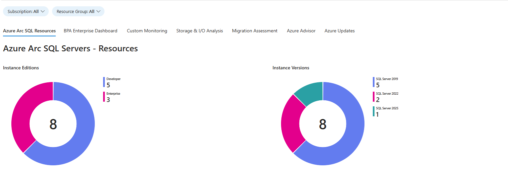

## What problem does the workbook solve?

The Azure Arc SQL Dashboard provides an Enterprise solution for managing and diagnosing SQL Server issues at scale across an Enterprise. It presents data insights from SQL Servers running On-Prem, Multi-Cloud and Azure and presents detailed best-practice and performance data in a single workbook that can be used to manage SQL Server at scale across an Enterprise. 

## What the workbook shows

| Area | Views |
|---|---|
| Azure SQL Server inventory | Instance editions and versions, database counts, instance details, and Arc machines with SQL Server installed |
| Best practices assessment (BPA) | Assessment runs for Azure Arc and Azure IaaS SQL Servers, issues by severity, server and database, check summaries, and check details |
| Custom Monitoring | Machine-level summary CPU and Disk perfomance Metrics and a trend chart for the selected machine |
| Storage I/O Analysis| Disk latency summary and a trend chart for the selected machine |
| Migration assessment | Readiness for Azure SQL Database, Azure SQL Managed Instance, and SQL Server on Azure VMs; server and database drill-downs, blockers, features requiring planning, and shared dependencies |
| Azure Advisor | All Advisor categories for Arc SQL hosts and registered Azure SQL VMs; estate totals, category/impact/coverage pies, machine totals, and selectable recommendation details |
| Azure Updates | Update Manager assessment coverage, missing patch/reboot totals, three pies, host summaries, affected-machine patch totals, and selectable missing-patch details |
| Windows Health | Windows SQL hosts on Arc and Azure IaaS: machine inventory, OS support dates, missing updates, baseline/policy compliance, and installed software |

Windows Health uses Resource Graph for machine, update, compliance, and Defender
software inventory. Estate-wide patch lists remain in Azure Updates; Windows Health
retains update status and drill-downs under Machines, without a separate Updates
subtab. Host scope uses SQL VM registration, Arc SQL instance inventory, or Arc SQL
discovery, joined to full Windows Compute/Arc machine resource IDs. Unregistered
and undiscovered SQL hosts are not included. Native VMs do not have an Arc
connection status. Change Tracking software views require selecting a machine
under Machines and a Log Analytics workspace with `ConfigurationData` /
`ConfigurationChange` containing that host's full resource ID; name-only records
are not matched. Defender software and compliance summaries remain estate-wide.
OS support status uses embedded lifecycle dates and does not account for ESU
entitlement. When current OS details are unavailable, known Windows Server/SQL
marketplace image metadata supplies the OS family; custom images can remain
unknown, and image metadata does not prove the current OS after an in-place upgrade.
The Defender software view also expands returned Defender for Cloud software-update
assessments into CVE rows across the selected SQL-host/resource-group scope, with
affected-host counts/names, detected versions, and NVD reference links; each row
groups a software/CVE pair. The original inventory vulnerability count remains an
aggregate.

## Filtering 
### Global Filters for subscription and resource-group

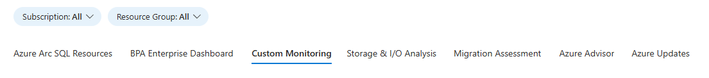

### Tab specific filters for Log Analytics Workspace and Time Range

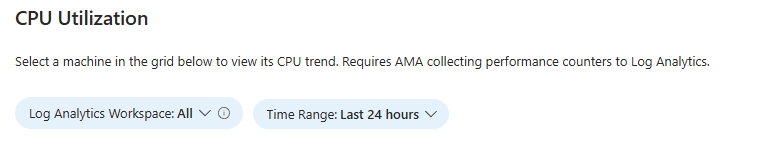

 ## Azure Arc SQL Resources Tab

Provides an overview and Inventory of On-premises and Multi-Cloud Arc Enabled SQL Servers.

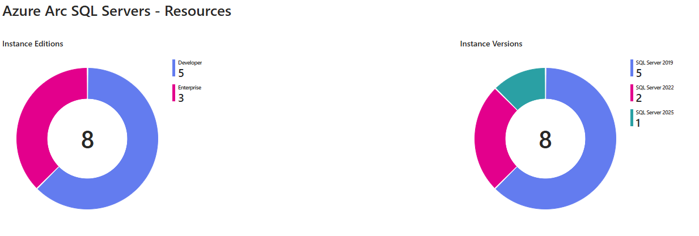
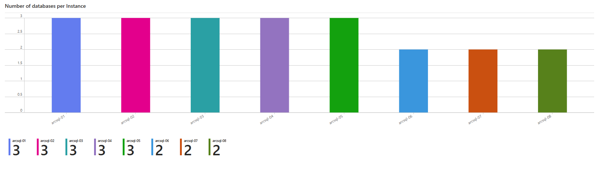
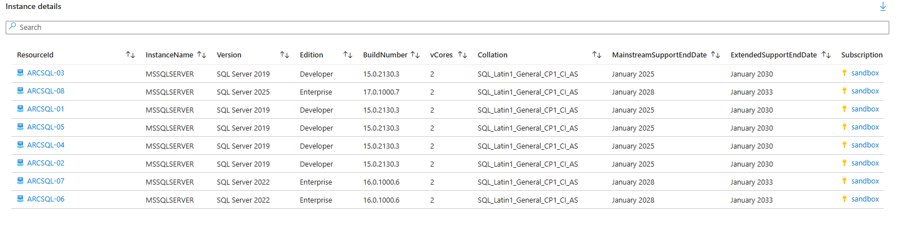

 ## BPA Enterprise Dashboard Tab

Provides an Enterprise view of the Best Practices Analyser results.

 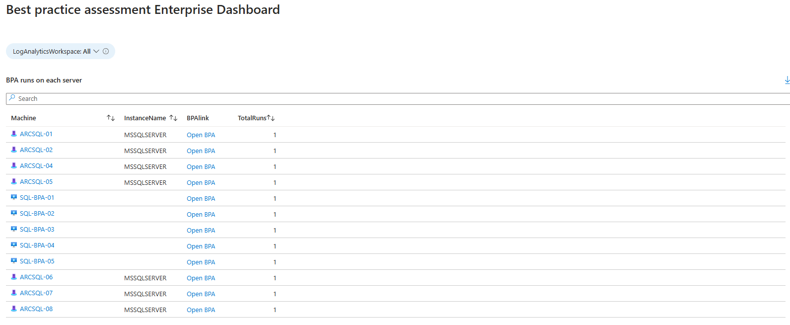
 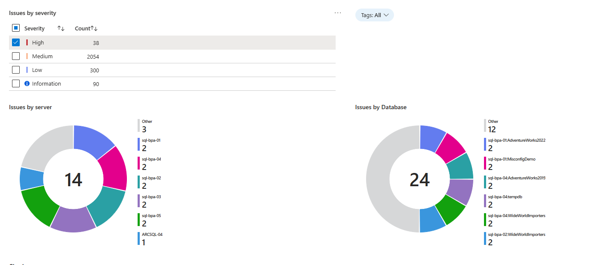
 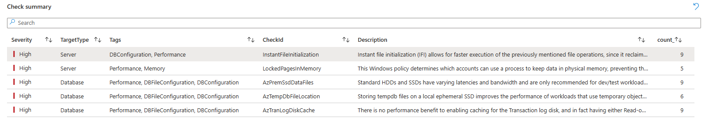
 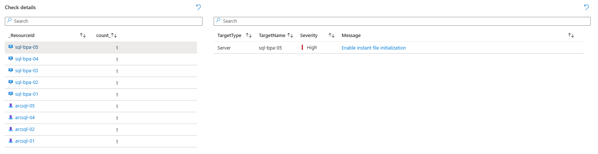

 ## Custom Monitoting Tab

 Provides Monitoring metrics for CPU and Storage

 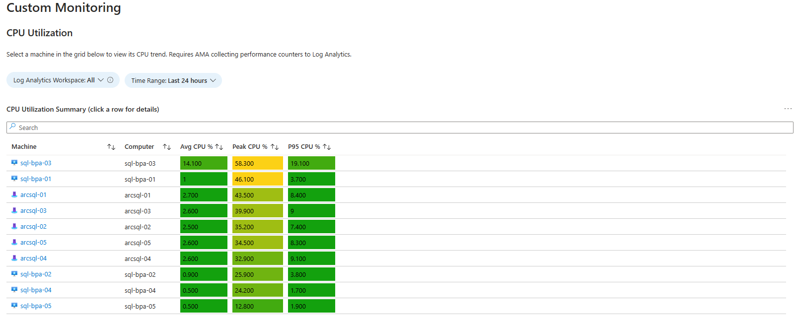
 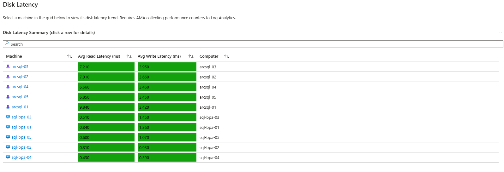

 ## Storage & I/O Analysis Tab

 Provides detailed Storage and I/O information for performance tuning

 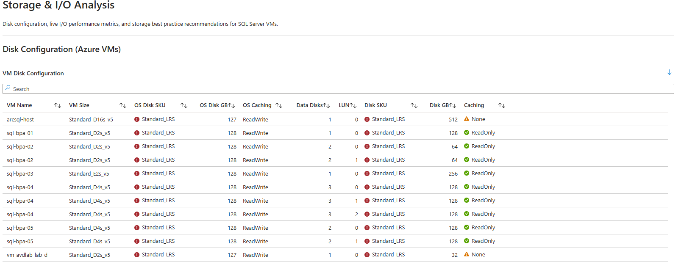
 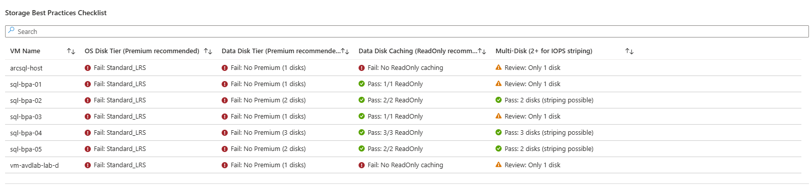
 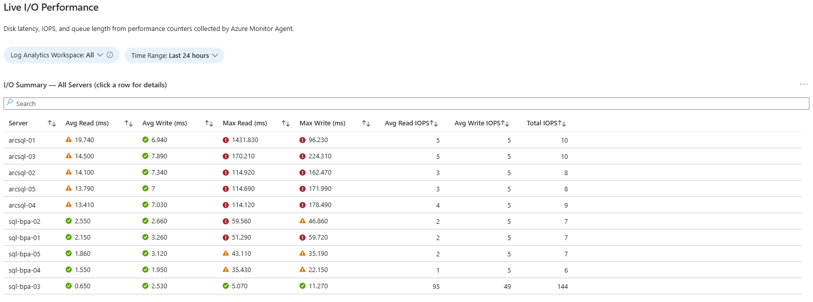

 ## Migration Assessment Tab

 Migration assement for Azure SQL 

 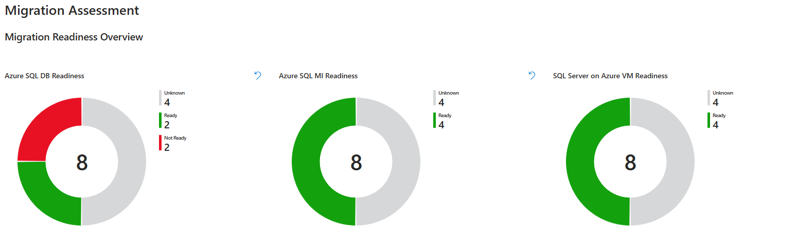
 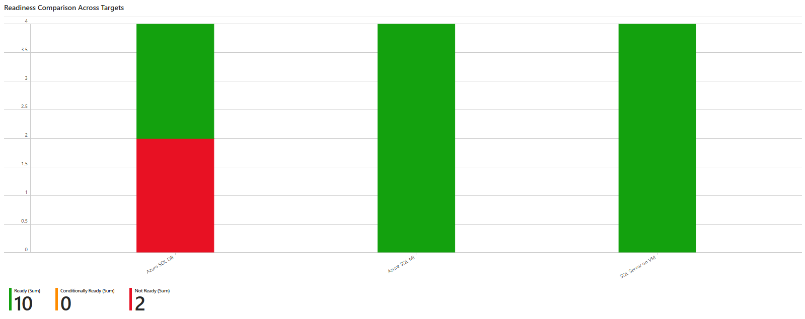
 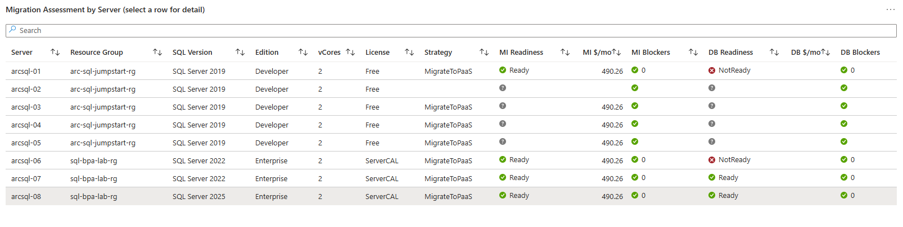
 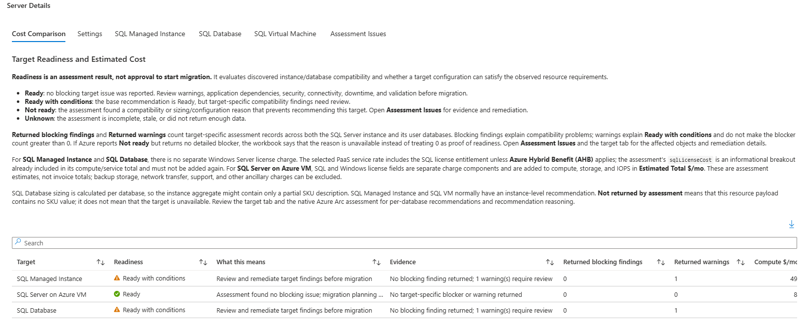
 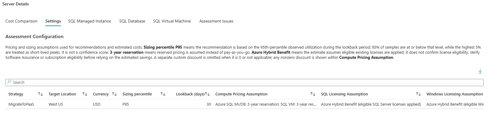
 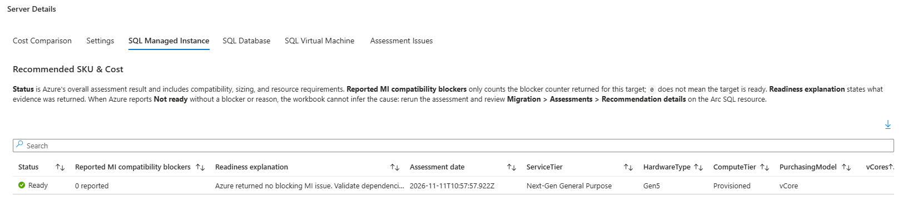
 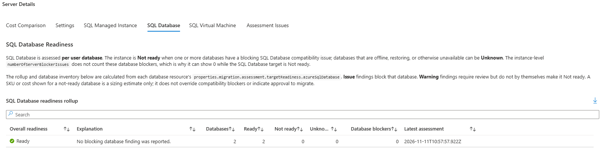
 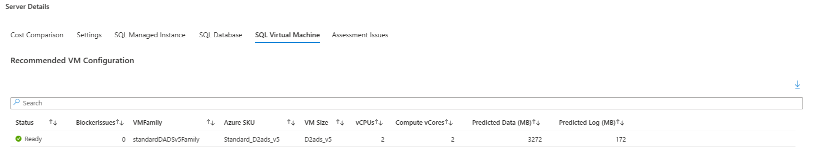
 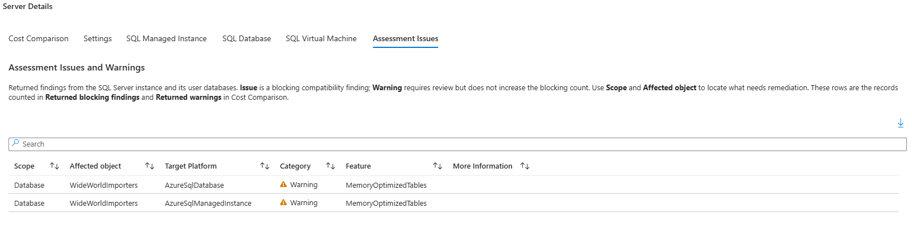

 ## Azure Advisor Tab

 Azure Advisor recommendations for SQL Servers

 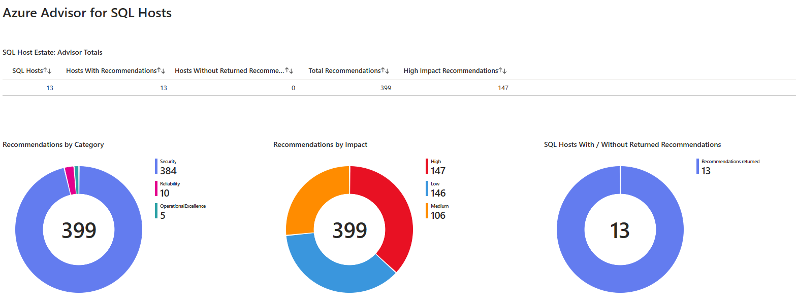
 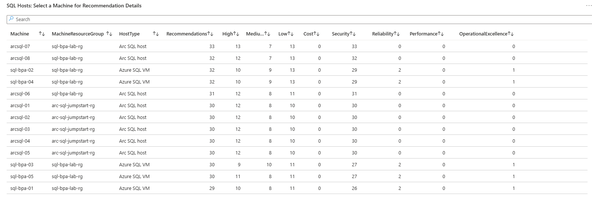

 ## Azure Updates Tab

 Azure Updates information for SQL Servers

 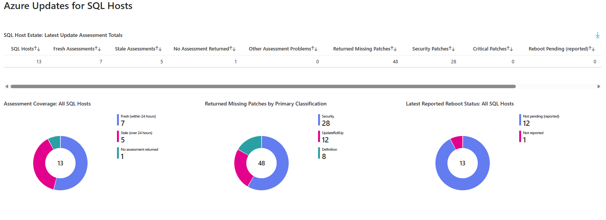
 

## Windows Health

Shows and overview of information for Windows Health for SQL Servers detailing Machine Configuration and Azure Policies, Azure Defender Inventory and Azure Chnage Tracking and Inventory Data.

 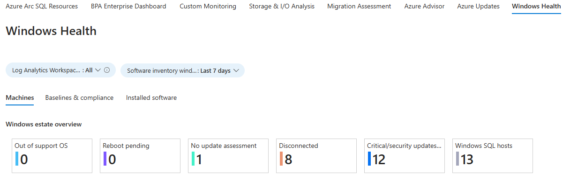
 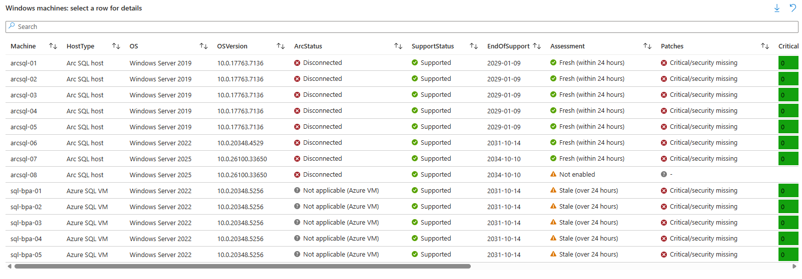
 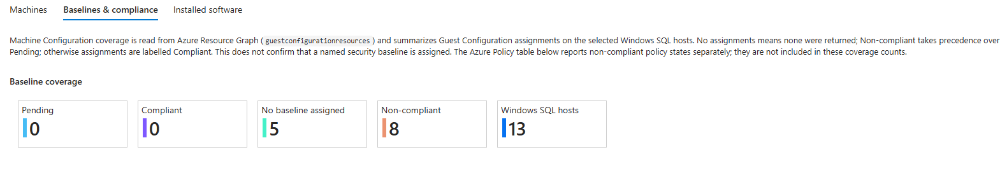
 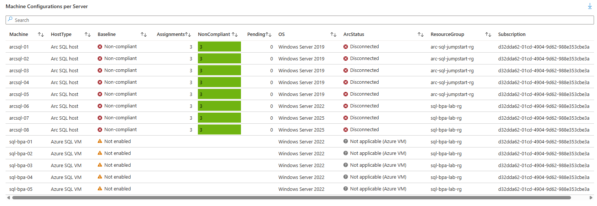
 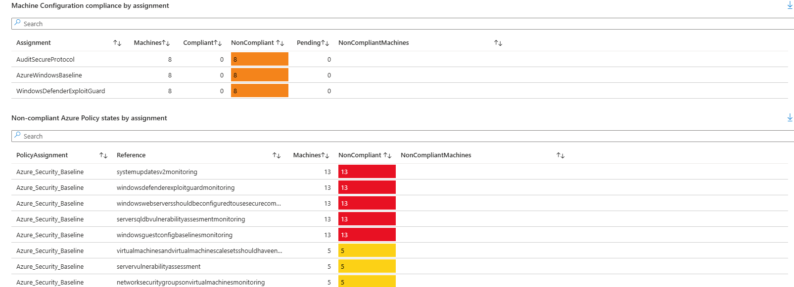
 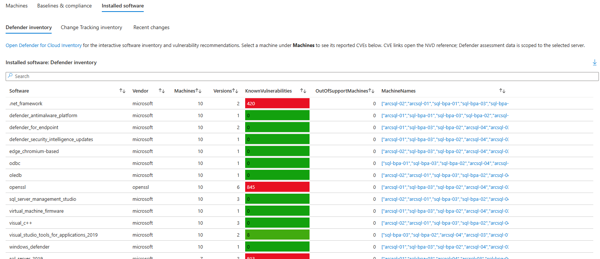
 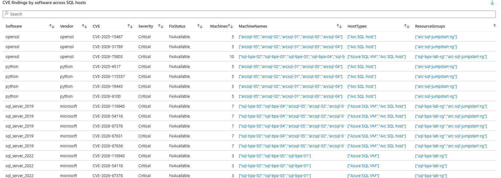

## Data and access requirements

The workbook visualizes existing data; importing it does **not** install agents,
enable assessments, or create data collection rules.

| Data | Source / prerequisite |
|---|---|
| Inventory and migration readiness | Azure Resource Graph; SQL Server instances connected to Azure Arc, with migration assessment data populated for readiness views |
| CPU and disk latency | Log Analytics performance data collected through Azure Monitor Agent (AMA); queries support `Perf` and relevant `InsightsMetrics` data |
| BPA findings | `SqlAssessment_CL`, including CSV assessment records in `RawData` and the originating machine's `_ResourceId` |
| Azure Advisor | Resource Graph `advisorresources` joined by full resource IDs to SQL VM registrations, Arc SQL instance parents, or Arc machine SQL discovery; no Log Analytics workspace required |
| Azure Updates | Resource Graph `patchassessmentresources`; Update Manager assessments must have run on the SQL hosts; no Log Analytics workspace required |

## Import the workbook

1. Download or clone this repository.
2. In the Azure portal, open **Azure Monitor > Workbooks** and create a new workbook.
3. Enter **Edit** mode and open the **Advanced Editor** (`</>`).
4. Choose the workbook/gallery JSON editing mode rather than an ARM template,
   if the editor offers that choice.
5. Replace the editor contents with the full contents of
   [the primary workbook JSON](AzureBPAWorkbook/Azure%20Arc%20SQL%20Dasbboard%20w%20cpu%20and%20io%20and%20assessment.json),
   then select **Apply**.
6. Select your subscriptions, resource groups, and Log Analytics workspaces.
7. Save the workbook with a descriptive name in your chosen subscription,
   resource group, and region.

This file is serialized workbook content, not a standalone ARM deployment
template. Files in [olderVersions](AzureBPAWorkbook/olderVersions) are historical
variants, not the primary dashboard.

## Microsoft documentation

- [Azure Workbooks](https://learn.microsoft.com/azure/azure-monitor/visualize/workbooks-overview)
- [SQL Server enabled by Azure Arc](https://learn.microsoft.com/sql/sql-server/azure-arc/overview)
- [Arc SQL best practices assessment](https://learn.microsoft.com/sql/sql-server/azure-arc/assess)
- [SQL VM best practices assessment](https://learn.microsoft.com/azure/azure-sql/virtual-machines/windows/sql-assessment-for-sql-vm)

## Documentation index

### Lab setup

- [Lab setup guide and sample data/misconfigurations](docs/LAB-SETUP.md)
- [Azure Terraform lab](docs/AZURE-TERRAFORM-LAB.md)
- [Hyper-V lab](docs/HYPER-V-LAB.md)
- [Azure-hosted Arc SQL Jumpstart lab](docs/ARC-JUMPSTART-LAB.md)

### Monitoring and assessments

- [Monitoring setup: agents, DCRs, and alerts](docs/MONITORING-SETUP.md)
- [Arc SQL BPA enablement](docs/ENABLE-ARC-SQL-BPA.md)
- [Performance counter reference](docs/PERFORMANCE-COUNTERS.md)
- [Creating alerts](docs/CREATING-ALERTS.md)
- [DCR/DCE migration](docs/DCR-DCE-MIGRATION.md)